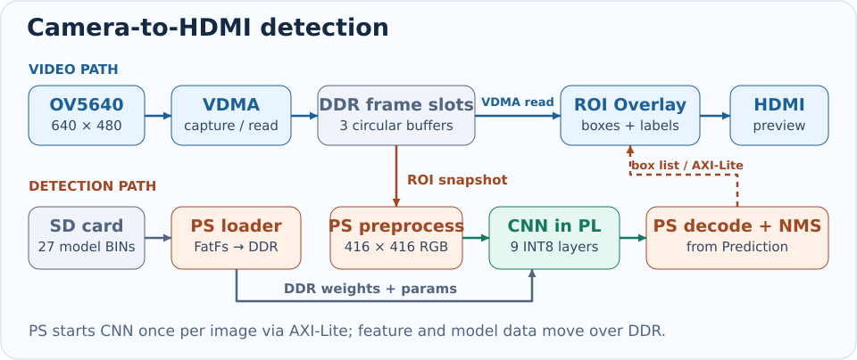
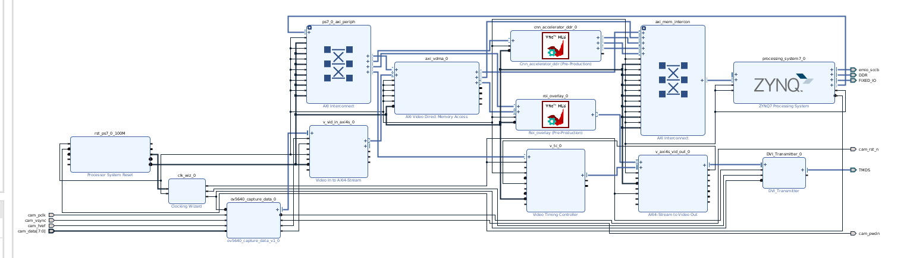
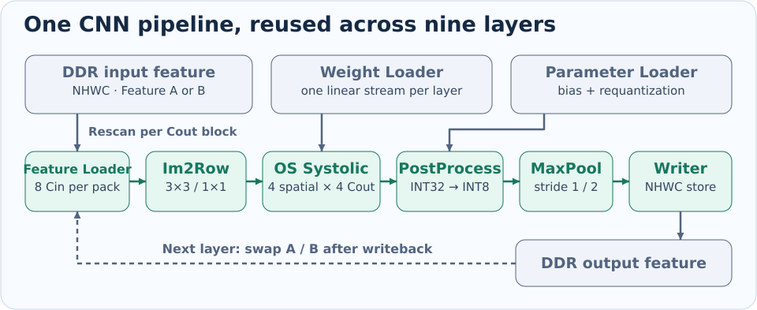
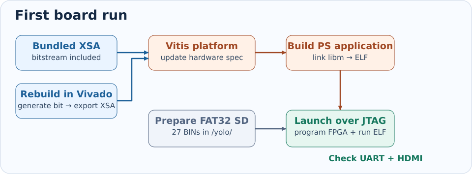

# YOLOv2-tiny INT8 FPGA Accelerator

在 Zynq-7000 上运行 YOLOv2-tiny VOC 的 FPGA 目标检测工程：**OV5640 实时采集，PL 完成九层 INT8 卷积推理，PS 完成检测解码和 NMS，HDMI 叠加检测结果。** 工程包含 Vitis HLS 源码、Vivado 板级工程和 Vitis 裸机应用。网络固定为 416×416 RGB、batch=1、20 类，不是通用模型部署框架。

[系统架构](#系统架构) · [网络结构](#网络结构) · [卷积数据流](#卷积数据流) · [资源与性能](#资源与性能) · [构建与上板](#构建与上板) · [HLS 验证](#hls-验证)

## 系统架构



系统有两条并行路径：**视频路径**持续输出预览；**检测路径**每轮从稳定的 VDMA 帧槽抓取一份 ROI，完成推理和解码后更新画面上的检测框。预览不必等待推理结束，也不会把绘制后的像素送回 CNN。

| 阶段 | 哪里运行 | 做什么 |
|---|---|---|
| 采集与预览 | PL：OV5640 Capture、VDMA、视频输出 IP | 捕获 640×480 视频，经 VDMA 在 DDR 三帧缓冲中循环写入和读出；从视频输出侧叠加显示 |
| 启动与模型加载 | PS：Cortex-A9 裸机应用 | 通过 FatFs 从 SD 卡读取 27 个模型 BIN；按层将权重和量化参数放进 DDR，只在启动时加载 |
| 图像预处理 | PS | 独立抓取 416×416 ROI，按 RGB 通道做整数归一化和量化，在 Feature A 区生成紧凑的 INT8 NHWC 输入 |
| CNN 推理 | PL：`cnn_accelerator_ddr` | PS 初始化时通过 AXI-Lite 设置 Feature、权重和参数的 DDR 基址，每幅图单独启动并轮询完成位；CNN 通过 AXI Master 搬运数据 |
| 解码与显示 | PS + PL：`roi_overlay` | PS 等待推理完成，从 Feature B 区读取 Prediction，完成解码、阈值筛选和 NMS；Overlay 在视频帧边界应用检测列表，绘制框、类别和概率，ROI 外填黑 |

CNN 按图像逐次启动，下一轮开始前 PS 已读完本轮输出；没有固定 10 fps 的节拍，也不逐帧打印 UART。Overlay 自由运行（`ap_ctrl_none`），PS 提交检测列表，不启动 Overlay 数据通路。

### Vivado Block Design

[](docs/images/vivado-block-design.png)

BD 中，PS 从 `M_AXI_GP0` 发出 AXI-Lite 配置访问；CNN 的三个 AXI Master 与 VDMA 的读写 Master 经内存互联接到 PS 的 `S_AXI_HP0`，共享 DDR。视频流从 `axi_vdma_0/M_AXIS_MM2S` 进入 `roi_overlay_0`，再送到 AXI4-Stream 视频输出模块及 DVI/HDMI 发送端。完整连线、时钟与复位见 [Vivado 工程说明](vivado/README.md)。

## 网络结构

输入为 **416×416×3 signed INT8 RGB**。Conv1–Conv8 使用 stride=1、padding=1 的 3×3 卷积。后处理先加 bias，再按结果正负选择重定标系数，把 LeakyReLU（α=0.1）合在一次整数重定标中。Prediction 使用 stride=1、padding=0 的 1×1 卷积，重定标后直接输出，不加激活。

| 层 | 卷积 | Cin → Cout | MaxPool | 层输出 H×W×C（池化后） |
|---|---|---:|---|---|
| Conv1 | 3×3 | 3 → 16 | 2×2 / stride 2 | 208×208×16 |
| Conv2 | 3×3 | 16 → 32 | 2×2 / stride 2 | 104×104×32 |
| Conv3 | 3×3 | 32 → 64 | 2×2 / stride 2 | 52×52×64 |
| Conv4 | 3×3 | 64 → 128 | 2×2 / stride 2 | 26×26×128 |
| Conv5 | 3×3 | 128 → 256 | 2×2 / stride 2 | 13×13×256 |
| Conv6 | 3×3 | 256 → 512 | 2×2 / stride 1，右/下补边 | 13×13×512 |
| Conv7 | 3×3 | 512 → 1024 | 旁路 | 13×13×1024 |
| Conv8 | 3×3 | 1024 → 1024 | 旁路 | 13×13×1024 |
| Prediction | 1×1 | 1024 → 125 | 旁路 | 13×13×125 |

最后一层每个网格位置有 5 个锚框，每个锚框包含 4 个坐标量、1 个目标置信度 logit 和 20 个类别 logit。125 是逻辑通道数；DDR 每位置步长为 128 B，末尾 3 字节为零。Sigmoid、类别 Softmax 和 NMS 在 PS 上执行。固定层表见 [`config.h`](hls/cnn_accelerator/src/config.h)。

## 卷积数据流



| 模块 | 主要职责 |
|---|---|
| [Feature / Weight / Param Loader](hls/docs/yolov2_tiny_ddr_io.md) | Feature 按 NHWC 从 DDR 读出，内部每个 Pack 携带 8 个 Cin；首层的 RGB 在这里扩成 8 路。不改变 DDR 中紧凑 RGB 的布局。Weight、Param 按整层的导出顺序供流 |
| [Im2Row](hls/docs/im2row.md) | 3×3 路径用行缓冲和滑窗在线取数，处理空间补零；1×1 路径只组装相邻空间位置。不在 DDR 或片上生成整张展开矩阵 |
| [OS Systolic](hls/docs/systolic_os.md) | 4 个同一行的连续空间位置 × 4 个输出通道，形成 16 个 PE；每个 PE 对 8 路 Cin 做点积，结果在 PE 内累加为 INT32。激活横向传播，权重纵向传播 |
| [ConvPostProcess](hls/docs/conv_postprocess.md) | 每 Cout 加 bias，按整数 multiplier/shift 重定标，并按层配置应用 LeakyReLU，输出 signed INT8 |
| [MaxPool](hls/docs/pool.md) | 处理 2×2 stride 2、2×2 stride 1 或旁路；行缓存只保留当前 Cout 块所需数据 |
| [Feature Writer](hls/docs/yolov2_tiny_ddr_io.md) | 根据空间坐标和全局 Cout 写回 NHWC；流按 Cout 块先后到达，不是按整张图的最终地址顺序到达 |

**层内：** 每次驻留最多 32 个 Cout 的权重，阵列仍只并行计算 4 个 Cout。每个驻留块要从 DDR 重扫一次本层输入，Im2Row 重新建立滑窗。块内，同一个空间 Tile 的窗口只从 Im2Row 读一次，其余 4-Cout Tile 从本地激活缓存回放。权重先装入当前块缓存，再在所有空间 Tile 上复用。这样不用在片上保存整层权重，代价是重读输入并重复生成窗口。

**层间：** 九层顺序复用同一套计算模块，不是九套卷积 IP。Feature A/B 是同一个 DDR 分配中的两段，各 692,224 B。Conv1 读 A 写 B，Conv2 读 B 写 A，之后继续交替；整层完成并写回后才启动下一层。第九层结果落在 B。详细调度见 [DDR Top](hls/docs/top.md)。

## 资源与性能

下表为 **Vivado 2022.2、XC7Z020-2（CLG400）** 的完整 `system_wrapper` 实现（2026-11-18），包括 CNN、摄像头/HDMI 视频链路、Overlay 和 AXI 互联。该次生成的 bitstream 与仓库 XSA 内的 bitstream 一致。资源取自布局后报告，时序取自布线后报告，均不是单独 CNN 的 HLS 估算。

| 指标 | 使用量 / 总量 | 占用 |
|---|---:|---:|
| Slice LUT | 32,990 / 53,200 | 62.01% |
| Slice Register | 48,017 / 106,400 | 45.13% |
| BRAM Tile（36 Kb 等效） | 136.5 / 140 | 97.50% |
| DSP | 155 / 220 | 70.45% |

CNN 连接到 **125 MHz** 的 PS FCLK0（周期 8.000 ns）。布线后整工程报告 **WNS +0.405 ns、TNS 0 ns、WHS +0.025 ns**，报告中的用户时序约束满足。BRAM 是该版余量最小的资源；LUT/DSP 尚有余量，不等于可以同比扩大阵列。

- **计算量：** 固定九层约 **3.49 GMAC/图**（只计有效逻辑通道的卷积 MAC，1 MAC 计 1）。按层表、空间/Cout Tile 数、归约步数和每 Tile 6 步的阵列排空计算，全网约 **3,527 万个阵列推进步**；其中 Conv7 和 Conv8 合计约 66%。
- **理想化参考：** 假定每个阵列推进步均为一个周期，125 MHz 下约 **282 ms/图（约 3.54 图/s）**。这是仅计阵列推进的估算，未计权重装载、DDR 仲裁/反压、行缓冲预填、PS 预处理及解码等开销，**不是板测 FPS**。已验证摄像头、推理、解码和 HDMI 显示功能；这里没有发布端到端帧率或精度基准。

报告来源：Vivado `impl_1` 的 `system_wrapper_utilization_placed.rpt` 与 `system_wrapper_timing_summary_routed.rpt`，在本地实现目录生成，不随源码提交。阵列推进步的估算可用上面的层表复算：逐层累加 `H × ceil(W/4) × ceil(Cout/4) × (Kh × Kw × ceil(Cin/8) + 6)`，其中 H、W 是卷积输出尺寸，未经过池化。

## 构建与上板



**准备环境。** 使用 Vivado / Vitis Classic 2022.2；重建自定义 IP 才需要 Vitis HLS 2022.2。验证目标是 `xc7z020clg400-2` 板级工程和 OV5640、HDMI、UART、JTAG、SD 卡。相同 FPGA 型号不代表板卡兼容，移植前应核对 DDR/MIO、时钟及引脚约束。以下路径均以仓库根目录为基准。

1. **准备模型 SD 卡。** 使用 FAT32，把同一次模型导出的 27 个 BIN（九层各有 weight、bias、quant 文件）直接放到 SD 根目录的 `yolo/`，例如 `yolo/conv1_weight.bin`。不要保留额外的 `bins/` 层。模型 BIN、训练权重和 trace 不随 Git 提供，目前也没有公开模型下载地址；**仅克隆仓库可以构建工程，但缺少配套 BIN 时不能完成板上检测**。详见 [模型与测试数据](hls/docs/data.md)。
2. **选择硬件。** 对匹配的板卡，可直接使用仓库提供的 [`vitis/system_wrapper.xsa`](vitis/system_wrapper.xsa)，内含 bitstream。若要重建，打开 [Vivado XPR](vivado/cnn_accel_cam/cnn_accel_cam.xpr)，按 [Vivado 构建步骤](vivado/README.md#打开和构建vivado)检查 IP、Validate BD、生成 bitstream，导出 XSA 时勾选 **Include bitstream**。板级工程已带两套打包 IP，这两条路径都不要求先运行 HLS。
3. **构建 Vitis 平台和应用。** 导入 `system_wrapper`、`cnn_accel_cam` 和 `cnn_accel_cam_system`。首次导入先右键平台 `system_wrapper` → **Update Hardware Specification**，重新选择本地 XSA，再 Build Platform。应用关联本地生成的 XPFM，确认 BSP 启用 `xilffs` 和长文件名。在应用 **Properties → C/C++ Build → Settings → Tool Settings → ARM v7 gcc linker → Libraries** 检查当前配置有 `m`，再构建 ELF。用配套模型时保留仓库中两个 `camera_model_*.h`，无需运行 Python。
4. **通过 JTAG 启动。** 接好摄像头、HDMI、JTAG、UART 并插入模型 SD 卡。在应用启动配置 **Target Setup** 勾选 **Program FPGA**；若 **Bitstream File** 没有自动识别，手动 **Search…** 或 **Browse…** 选择与 XSA 匹配的 `system_wrapper.bit`，同时使用配套的 PS 初始化和刚构建的 ELF。JTAG 流程不需要 `BOOT.BIN`。
5. **确认运行。** 串口设为 115200、8N1；应看到 `Model: all 27 files loaded` 和 `[APP] Continuous YOLO detection/overlay ready`。HDMI 应显示 ROI 实时画面；出现通过筛选的目标时叠加检测框及文字。没有逐帧 UART 日志属于正常行为。

完整界面步骤见 [Vitis 首次构建和下载](vitis/README.md)。更换权重模型时，应按 [脚本说明](scripts/README.md) 从同一份导出 metadata 更新 PS 的输入/输出配置头，不能混用不同模型的头文件和 BIN。

## HLS 验证

下列命令是从仓库根目录开始的 Linux/Bash 示例。先加载 Vitis HLS 2022.2 环境：

```bash
mkdir -p build/hls
cd build/hls
vitis_hls -f ../../hls/roi_overlay/script/hls_roi_overlay.tcl
```

上面只运行 Overlay 的 C 仿真，会自行构造视频和检测数据。CNN 的验证需要按 [数据契约](hls/docs/data.md) 把配套模型和 golden trace 分别放在 `data/yolov2_tiny/bins/`、`data/yolov2_tiny/trace/`，然后在同一目录运行：

```bash
vitis_hls -f ../../hls/cnn_accelerator/script/hls_ddr.tcl
```

CNN 脚本默认运行 C 仿真；设置 `YOLO_HLS_STAGE=csynth` 可单独跑综合。无需设置测试数据路径环境变量。模块级 Top、testbench 对应关系及手动工程设置见 [HLS 说明](hls/README.md)。HLS 命令和路径定位已在 Linux 验证；Windows 的端到端构建未验证，请勿在 PowerShell/CMD 中直接执行上述 Bash 命令。

## 仓库导航

| 入口 | 内容 |
|---|---|
| [hls/](hls/README.md) | CNN 与 Overlay 的源码、测试和构建方式；[模块设计](hls/docs/) |
| [vivado/](vivado/README.md) | 板级工程、约束、已打包 IP 和 XSA 导出 |
| [vitis/](vitis/README.md) | 平台、BSP、裸机摄像头/YOLO 应用及上板流程 |
| [scripts/](scripts/README.md) | 从模型导出 metadata 生成 PS 配置头；使用配套模型复现时可跳过 |
| [data/yolov2_tiny/](data/yolov2_tiny/README.md) | 模型与仿真数据的目录约定 |
| `build/` | 本地工程、日志和报告，不纳入版本管理 |

修改 HLS 功能或布局时，请同步更新接口文档和对应 testbench。影响硬件时，重新导出对应 IP 和 XSA，并用更新后的平台/BSP 构建 PS 应用。提交验证结果时应区分 C 仿真、RTL 协同仿真、综合、布局布线和板测。
