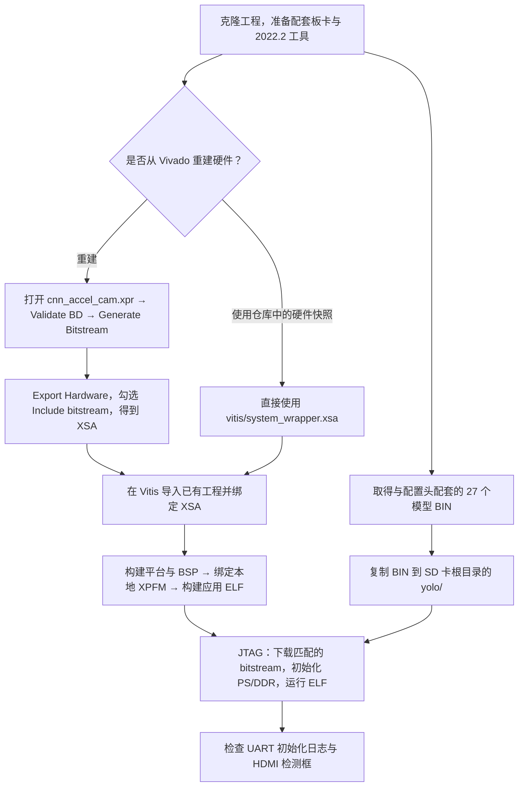

# YOLOv2-tiny INT8 FPGA Accelerator

基于 Vitis HLS / Zynq-7000 的 YOLOv2-tiny VOC 目标检测工程，包含 HLS 计算模块、
Vivado 摄像头/HDMI 工程和 Vitis 裸机应用。网络采用固定九层结构，面向学习与实现
FPGA 推理数据通路，不是任意网络的通用部署框架。

当前已完成测试及上板功能验证（2026-11-19验证基线），能够连续执行摄像头取帧、
整数预处理、PL 推理、PS 解码/NMS 和 HDMI 检测框显示。具体帧率、精度及最终资源
应以对应版本的实测和实现报告为准，历史 HLS 估计不作为当前板测指标。

## 首次使用：选择复现路径

仓库提供的是**可重新构建的工程**，不是可直接烧录的发布包。它保留 Vivado 工程和已打包
的自定义 IP、Vitis 平台与应用源码、配套 XSA（含 bitstream），以及两份已生成的
PS 模型配置头。不提供已构建的应用 ELF、BSP 库、`BOOT.BIN`、模型 BIN、训练权重
或仿真 trace。



1. **准备数据。** 首次上板只需要同批导出的 27 个模型 BIN。取得文件后，将
   `bins/` 中的文件直接复制到 SD 卡根目录的 `yolo/`，例如
   `yolo/conv1_weight.bin`，不要放成 `yolo/bins/conv1_weight.bin`。
   推荐 FAT32。只通过 JTAG 运行不需要 `BOOT.BIN`，也不需要 trace 或
   `metadata.json`。**仓库目前没有公开模型数据下载地址**，仅克隆代码可构建，
   但缺少配套 BIN 时不能完成板上推理。参见[数据清单与放置规则](hls/docs/data.md)。
2. **准备硬件。** 从 Vivado 重建，按[硬件构建与 XSA 导出](vivado/README.md#打开和构建vivado)
   操作；若使用仓库内的 XSA 且没有改硬件，可直接进入 Vitis。
3. **构建和运行软件。** 按[Vitis 首次构建与下载](vitis/README.md#从干净克隆准备平台)导入
   工程、构建 BSP 和 ELF，然后通过 JTAG 启动。使用仓库配套模型时保留
   `camera_model_input.h`、`camera_model_output.h`，**无需运行 Python 脚本或重新生成 HLS IP**。

如果只想验证 HLS，不需要接板或准备 SD 卡。CNN 的 BIN 对照测试从
`data/yolov2_tiny/bins/`、`data/yolov2_tiny/trace/` 读取；Overlay 测试不读取外部数据。
如果更换模型，才需要[生成与新模型配套的 PS 配置头](scripts/README.md)。

## 环境与路径约定

本文中的“仓库根目录”指同时包含`README.md`、`hls/`和`vivado/`的目录，不是`hls/`。
除非另有说明，文件路径和命令的起始位置均以仓库根目录为基准；不要求仓库使用特定名称。

| 项目 | 要求或验证范围 |
|---|---|
| FPGA | `xc7z020clg400-2`；引脚、DDR及外设配置针对现有板级工程，不代表所有Zynq板卡可直接使用 |
| 开发工具 | Vivado、Vitis HLS、Vitis Classic IDE 2022.2；不是新版Vitis Unified IDE流程 |
| HLS运行环境 | 当前脚本与测试路径处理在 Linux 验证；HLS 总览中的命令使用 Bash |
| Windows | 工具本身提供Windows入口，但本仓库的HLS路径回退和编译参数引用尚未完成Windows验证，不能按“一键复现”承诺 |
| Python | 使用Python 3，辅助脚本要求3.7或以上，仅依赖标准库；解释器命令可能是`python3`、`python`或`py -3` |
| 模型数据 | 另行准备配套的模型BIN、metadata及所需trace；不随Git克隆提供 |

AMD提供Windows Vitis HLS命令行入口，并说明其使用MinGW环境；这与本仓库是否完成
跨平台验证是两回事。参见[HLS命令行说明](https://docs.amd.com/r/2022.2-English/ug1399-vitis-hls/Running-Vitis-HLS-from-the-Command-Line)。

## 系统分工

```text
OV5640 → VDMA / DDR → PS：裁切416×416 ROI、RGB整数归一化/量化
                  → PL：九层卷积 / LeakyReLU / Pool → DDR Prediction
                  → PS：sigmoid / softmax / NMS → Overlay → HDMI
```

HDMI 保留实时预览；Overlay 位于视频输出路径，不写回 CNN 的采集数据。
模型在启动时从 SD 一次性加载，之后连续推理，不固定为 10 fps，也不逐帧打印 UART。

## HLS 计算结构

- 目标器件为 `xc7z020-clg400-2`，工具版本为 Vitis HLS 2022.2。
- 输入为 `416×416×3` 紧凑 RGB INT8，内部使用 8 通道 Pack、4 个空间位置
  并行、4 个 Cout 并行的 OS Systolic。激活和权重为 signed INT8，累加为 INT32。
- 单层按最多 32 Cout 驻留。每个 Cout 块重新扫描 Feature，权重和参数按整层供流。
  层内通过 stream 流水，层与层之间通过 DDR A/B 两区交替，九层复用
  一套 Im2Row、Systolic、PostProcess 和 Pool。
- CNN 顶层入口是 `cnn_accelerator_ddr(feature, weights, params)`。
  PS 把紧凑 RGB 放在 Feature A 区，结果在 B 区；逻辑形状
  为 `13×13×125`，每像素物理步长 128 B。Top 不做检测框解码或 NMS。

详细契约见 [Top 设计](hls/docs/top.md)、[DDR 搬运与布局](hls/docs/yolov2_tiny_ddr_io.md)。
模块文档：
[Im2Row](hls/docs/im2row.md)、[OS Systolic](hls/docs/systolic_os.md)、
[ConvPostProcess](hls/docs/conv_postprocess.md)、[Pool](hls/docs/pool.md)。

## 工程目录

| 目录 | 内容 |
|---|---|
| [hls/cnn_accelerator/src](hls/cnn_accelerator/src) | HLS 模块、固定几何、DDR 布局和系统入口 |
| [hls/cnn_accelerator/testbench](hls/cnn_accelerator/testbench) | 模块级测试与 YOLO Top BIN 对照 |
| [hls/cnn_accelerator/script](hls/cnn_accelerator/script) | Vitis HLS 工程入口 |
| [hls/roi_overlay](hls/roi_overlay) | 独立视频遮罩、检测框及文字叠加核 |
| [hls/README.md](hls/README.md) | HLS 工程入口、测试运行方式与设计索引 |
| [hls/docs/](hls/docs/) | 模块设计、DDR 契约和测试数据说明 |
| [vivado/](vivado/README.md) | 摄像头、HDMI 和 YOLO 硬件工程 |
| [vitis/](vitis/README.md) | Zynq 裸机平台、BSP 与 PS 应用 |
| [scripts/](scripts/README.md) | Python 辅助脚本 |
| [data/yolov2_tiny/](data/yolov2_tiny/README.md) | 模型和测试数据放置位置；仓库只跟踪目录说明 |
| `build/hls/`、`build/ps/` | 本地检查、工程、日志和报告，不纳入版本管理 |

仓库目录名可以自选；Vivado/Vitis内部的工程名称沿用现有配置，不能仅重命名文件夹后
假定平台关联、项目标识和硬件交接文件会自动同步。

## 运行 HLS 验证

[HLS 总览](hls/README.md#脚本入口与运行产物)列出 CNN 和 Overlay 的构建与测试入口。
CNN 测试需要[配套模型和 trace](hls/docs/data.md)；Overlay 测试自行构造输入，不需要模型数据。

## 打开板级工程

[Vivado 工程说明](vivado/README.md)说明硬件工程；[Vitis 工程说明](vitis/README.md)说明软件平台和应用。[PS应用说明](vitis/cnn_accel_cam/README.md)
列出27个BIN的SD目录、DDR拼接、ROI整数预处理、连续推理、解码/NMS、检测框显示和构建步骤；
[Overlay设计](hls/docs/roi_overlay.md)说明显示与列表控制协议。当前 Overlay 使用
`ap_ctrl_none` 和显式 FLP 流水，不调用 Start；CNN 则由 PS 按图像逐次启动。
使用匹配当前硬件的XSA和BSP，Build Platform后再构建PS应用；软件检查和硬件Done不能代替板上数值及检测效果验证。

首次在另一目录打开 Vitis 时需要重新关联本地 platform；工具生成物、BSP 库和 IDE 状态
不随源码保存，具体恢复步骤见 Vitis 工程说明。不要为消除本机路径提示而改硬件参数。

## 贡献与验证

- 修改计算行为或数据布局时，同步更新相关接口说明和对应 testbench；涉及模型输出或 trace 时，说明所用的模型与导出版本。
- 提交时注明实际运行过的检查（C 仿真、RTL 协同仿真、综合或上板）。不要把静态检查或综合估计当成运行结果。
- 不提交工具缓存、个人工作区配置或本地模型数据。硬件变更涉及导出 IP、XSA 或 BSP 时，按[板级工程说明](vivado/README.md)核对它们是否配套。
